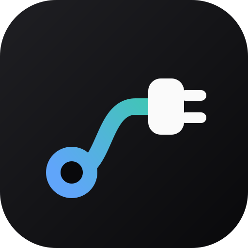
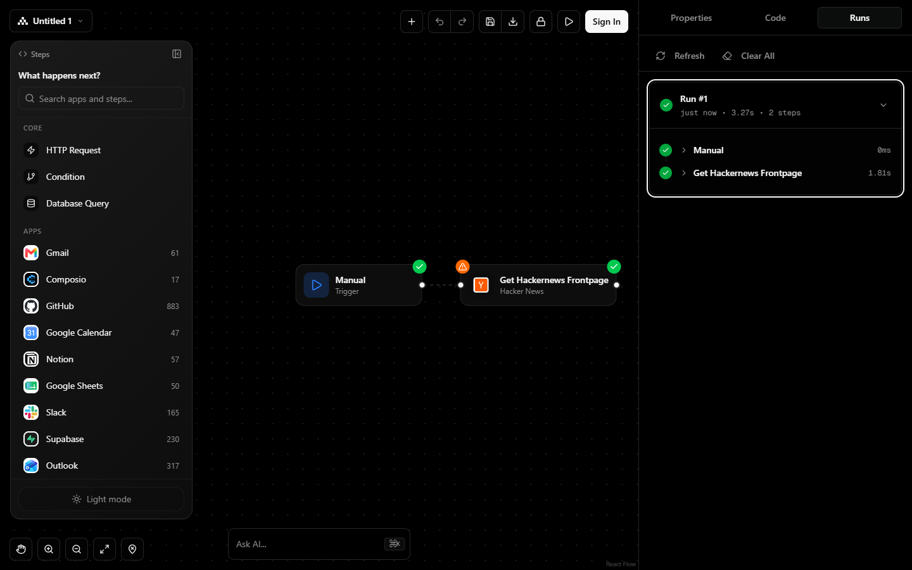

<p align="center">
  
</p>

<h1 align="center">Plugflow</h1>

<p align="center">
  The open-source workflow builder built on <a href="https://composio.dev">Composio</a>.<br />
  Drag 1,000+ apps onto a canvas. No OAuth apps to register, no integrations to write.
</p>



> **Status: early.** Browsing apps, adding their actions as nodes, connecting accounts and running workflows all work today. Triggers from apps and the agent step are on the roadmap below.

## Why Plugflow

Self-hosting an automation tool usually means creating your own OAuth app for every service you want to connect: Google, Slack, GitHub, each with its own console, redirect URLs and review process. Plugflow hands that whole layer to Composio.

- **Built on Composio.** Every app and action in the steps panel comes live from Composio's catalog, so new tools appear in Plugflow the day Composio ships them.
- **One key, 1,000+ apps.** Paste a Composio API key and browse Gmail, Slack, GitHub, Notion and the rest from the sidebar.
- **Forms, not JSON.** Pick an action and Plugflow builds its form from the tool's own schema, with required fields first.
- **Connect in two clicks.** Press Connect on an app and Composio's hosted page handles the sign-in. Plugflow never sees the tokens.
- **Runs with no accounts.** An embedded database and anonymous sign-in mean it works before you have signed up for anything but Composio.
- **Apache-2.0.** Use it, embed it, host it for others.

## How it works

1. Open the **Steps** panel on the left and pick an app.
2. Click an action. It lands on the canvas, already wired to the previous step.
3. Fill in the generated form. Type `{{` to insert a value from an earlier step.
4. Press Run. Each step executes through Composio, and the Runs tab shows the input, output and timing of every step.

## Quick start

You need Node.js 20 or newer and [pnpm](https://pnpm.io).

```bash
git clone https://github.com/demo55oo/plugflow.git
cd plugflow
pnpm install
cp .env.example .env.local
```

Fill in the two secrets in `.env.local`:

```bash
openssl rand -base64 32   # paste as BETTER_AUTH_SECRET
openssl rand -hex 32      # paste as INTEGRATION_ENCRYPTION_KEY
```

Start the embedded database in one terminal and leave it running:

```bash
pnpm db:local
```

In a second terminal, create the tables once and start the app:

```bash
pnpm db:push
pnpm dev
```

Open http://localhost:3000. On Windows, use `pnpm dev:webpack` instead of `pnpm dev`.

The embedded database is meant for trying Plugflow out. For anything you depend on, point `DATABASE_URL` at a real Postgres database and remove `DATABASE_POOL_MAX`.

## Add your Composio key

1. Create a free account at [platform.composio.dev](https://platform.composio.dev) and copy your API key.
2. Open Plugflow. The Steps panel asks for the key the first time; paste it and press Save. It is stored encrypted in your own database.
3. Pick an app and press **Connect** to sign in to it through Composio.

If you run Plugflow only for yourself, you can instead set `COMPOSIO_API_KEY` in `.env.local` and skip step 2.

## Where each key goes

| Key | Where to get it | Where it goes |
|---|---|---|
| Composio API key | [platform.composio.dev](https://platform.composio.dev) | The Steps panel in the app, or `COMPOSIO_API_KEY` in `.env.local` |
| `DATABASE_URL` | Nothing to get for local use; the default points at `pnpm db:local`. For production, any Postgres provider | `.env.local` |
| `BETTER_AUTH_SECRET` | Generate it yourself | `.env.local` |
| `INTEGRATION_ENCRYPTION_KEY` | Generate it yourself | `.env.local` |
| `AI_GATEWAY_API_KEY` | Optional, from [Vercel AI Gateway](https://vercel.com/ai-gateway). Only for the AI steps | `.env.local` |

Never commit `.env.local`. It is ignored by git.

## Templates

Starter workflows live in [`templates/`](templates). The first one, `github-issue-to-slack.json`, takes a webhook, fetches a GitHub issue and posts it to Slack, with both steps running through Composio.

## Roadmap

- Composio triggers (new email, new issue, new message) as workflow triggers
- Agent step that chooses among Composio tools
- Pick values from an earlier step's real output when filling a form
- One-click template import and a template gallery
- Docker image and one-click deploy

## Contributing

Issues and pull requests are welcome. Good places to start are new templates, new step types, and anything on the roadmap. Before opening a pull request, run:

```bash
pnpm type-check
pnpm fix
```

## Credits and license

Plugflow is licensed under [Apache-2.0](LICENSE). It is based on Vercel's [Workflow Builder Template](https://github.com/vercel-labs/workflow-builder-template); see [NOTICE](NOTICE). The canvas design is by Salaheddine Fikri.

Plugflow is an independent project. It is built on Composio's public API and is not affiliated with or endorsed by Composio or Vercel.
